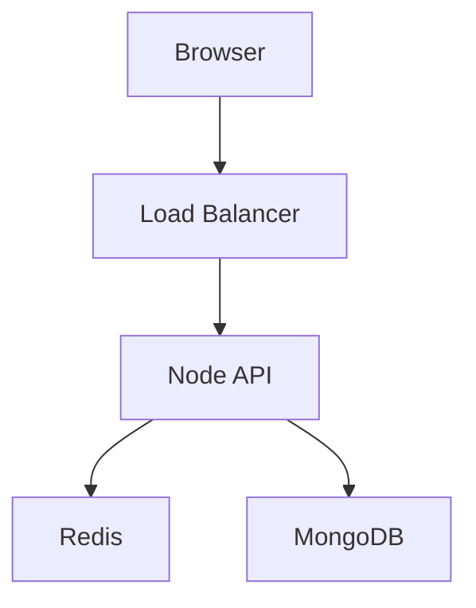

# Engineering Handbook — Notes Preparation Guide

## Purpose

This guide defines how every note in the `engineering-handbook` repository should be written, formatted, organized, illustrated, and maintained.

The goal is to create notes that remain:

- easy to understand
- easy to revise
- technically accurate
- visually clean
- interview friendly
- useful during real engineering work
- maintainable for many years

---

# 1. Core Rule

Every note should answer these questions:

1. What is it?
2. Why does it exist?
3. What problem does it solve?
4. How does it work?
5. When should I use it?
6. When should I not use it?
7. What are the trade-offs?
8. What can go wrong?
9. How do I debug it?
10. How would I explain it to another engineer?

Do not copy documentation.

Understand the concept first, then write it in your own words.

---

# 2. Standard Note Structure

Every technical topic should follow approximately this structure:

```markdown
# Topic Name

> One-line summary of the topic.

## What is it?

## Why does it exist?

## Mental Model

## How does it work?

## Important Concepts

## Example

## When to Use

## When Not to Use

## Advantages

## Disadvantages

## Trade-offs

## Common Problems

## Debugging

## Security Considerations

## Performance Considerations

## Interview Questions

## My Understanding

## References
```

Not every section is mandatory.

Use only sections that actually add value.

---

# 3. Heading Rules

Use headings consistently.

```markdown
# Topic

## Major Section

### Subsection

#### Small Detail
```

Recommended maximum depth:

```text
#    Topic
##   Section
###  Subsection
```

Avoid using more than three heading levels unless absolutely necessary.

Never use headings only for visual styling.

---

# 4. Font

Do not define custom fonts.

GitHub automatically renders Markdown using its own readable interface fonts.

This means:

- no custom font files
- no embedded Google Fonts
- no CSS font imports
- no font-specific HTML unless absolutely necessary

The content should remain readable anywhere Markdown is rendered.

---

# 5. Font Size

Do not manually control font sizes.

Use Markdown hierarchy instead:

```markdown
# Largest

## Large

### Medium

Normal text
```

Avoid:

```html
<font size="..."> <span style="font-size:..."></span></font>
```

These reduce portability and often render inconsistently.

---

# 6. Colors

Avoid custom text colors.

Do not write notes like:

```html
<span style="color:red">Important</span>
```

Instead use semantic markers.

Use:

```text
✅ Correct
❌ Incorrect
⚠️ Warning
💡 Key idea
🔐 Security
🚀 Performance
🧠 Mental model
🐞 Debugging
🎯 Interview
```

Use emojis sparingly.

Recommended rule:

> Maximum one icon per important section or concept.

Do not turn every bullet into an emoji.

---

# 7. Emphasis

Use bold for important terms.

```markdown
HTTP is a **stateless application-layer protocol**.
```

Use italics only occasionally.

```markdown
This behavior is _implementation dependent_.
```

Avoid excessive bolding.

Bad:

```markdown
**HTTP** is a **PROTOCOL** used for **CLIENT SERVER COMMUNICATION**.
```

Good:

```markdown
HTTP is a **request-response protocol** used between clients and servers.
```

---

# 8. One-Line Summary

Every note should begin with a simple summary.

Example:

```markdown
# HTTP

> HTTP is an application-layer request-response protocol used for communication between clients and servers.
```

This becomes extremely useful during quick revision.

---

# 9. Mental Models

Every difficult concept should contain a simple mental model.

Example:

```text
Client
   ↓
HTTP Request
   ↓
Server
   ↓
Business Logic
   ↓
Database
   ↓
HTTP Response
   ↓
Client
```

Mental models should be simple enough to remember.

Avoid overly detailed diagrams in the beginning.

---

# 10. Diagrams

Use diagrams whenever relationships or flow are easier to understand visually.

Preferred order:

1. ASCII / text diagram
2. Mermaid diagram
3. Image only when necessary

## Simple diagrams

Prefer:

```text
Browser
   ↓
DNS
   ↓
Server
   ↓
Database
```

For simple concepts, text diagrams are better than images.

They are:

- searchable
- editable
- lightweight
- version controlled
- readable directly in GitHub

---

# 11. Mermaid Diagrams

Use Mermaid for architecture and more complex flows.

Example:



Good uses:

- architecture
- request flows
- sequences
- database relationships
- CI/CD flow
- Kubernetes architecture
- state transitions

Do not use Mermaid when a four-line ASCII diagram is enough.

---

# 12. Images

Images should only be added when they improve understanding.

Examples:

- AWS architecture diagram
- Kubernetes architecture
- browser DevTools screenshot
- Grafana dashboard explanation
- database execution plan visualization

Do not add images only for decoration.

---

# 13. Image Directory Structure

Do not place images randomly inside folders.

Use:

```text
assets/
├── networking/
├── system-design/
├── aws/
├── docker/
├── kubernetes/
├── databases/
└── frontend/
```

Example:

```text
assets/networking/http-request-response.png
```

Reference it:

```markdown

```

---

# 14. Image Naming

Use lowercase kebab-case.

Good:

```text
http-request-response.png
aws-vpc-architecture.png
docker-networking.png
kubernetes-service-flow.png
```

Avoid:

```text
Screenshot 2026-10-12.png
image1.png
final-image-new.png
diagram.png
```

The filename should explain what the image contains.

---

# 15. Image Format

Preferred:

```text
.svg   diagrams/icons
.png   screenshots
.webp  large compressed images
```

Avoid large JPG files when unnecessary.

For diagrams, prefer SVG because it stays sharp at any size.

---

# 16. Screenshot Rules

When adding screenshots:

- crop unnecessary browser/window areas
- remove personal information
- remove company information
- remove credentials
- remove tokens
- remove internal URLs
- remove customer data
- remove account IDs

Add a short explanation immediately below the screenshot.

Never use a screenshot instead of explaining the concept.

---

# 17. Tables

Use tables for comparisons.

Example:

| HTTP Method | Purpose        |
| ----------- | -------------- |
| GET         | Read           |
| POST        | Create/process |
| PUT         | Replace        |
| PATCH       | Partial update |
| DELETE      | Delete         |

Tables are especially useful for:

- comparisons
- commands
- status codes
- cloud services
- database differences
- interview summaries

Avoid very large tables.

If a table has more than roughly 7–8 columns, rethink the structure.

---

# 18. Code Blocks

Always specify the language.

Good:

```javascript
const user = await getUser(id);
```

```bash
curl https://example.com
```

```yaml
services:
  api:
    image: my-api
```

Avoid:

```text
const user = await getUser(id);
```

when it is actually code.

Syntax highlighting improves readability.

---

# 19. Code Example Rules

Every code example should demonstrate one idea.

Avoid pasting complete applications into notes.

Bad:

```text
500-line Express application
```

Good:

```javascript
app.get("/health", (req, res) => {
  res.status(200).json({ status: "ok" });
});
```

If the example requires a full project, place it under:

```text
projects/
```

and link to it from the note.

---

# 20. Commands

Commands should always use shell blocks.

```bash
docker ps
```

If output matters:

```text
CONTAINER ID   IMAGE      STATUS
abc123         node:20    Up 5 minutes
```

Keep command and output separate.

---

# 21. Definitions

Do not use dictionary-style definitions alone.

Bad:

> Load balancer: distributes network traffic.

Better:

> A load balancer distributes incoming traffic across multiple backend instances so a single server does not become the bottleneck or single point of failure.

Then add:

```text
Client
   ↓
Load Balancer
 ↙    ↓    ↘
API1 API2 API3
```

---

# 22. Real-World Examples

Every important topic should have at least one practical example.

Example:

```markdown
## Real-World Example

Suppose one Node API instance can safely handle 1,000 requests per second.

If traffic increases to 5,000 requests per second, multiple instances can run behind a load balancer.
```

This converts theory into engineering understanding.

---

# 23. Trade-Offs

Senior-level notes must include trade-offs.

Example:

```markdown
## Trade-offs

Redis caching improves latency and reduces database load.

However, it introduces:

- cache invalidation complexity
- additional infrastructure
- possible stale data
- memory cost
```

Avoid notes that make technologies look universally good.

---

# 24. "When Not to Use" Section

This is especially important.

Example:

```markdown
## When Not to Use Redis

Do not introduce Redis only because the system might become slow someday.

Start with the database unless measurements show that caching is necessary.
```

Understanding when **not** to use something is often more senior than knowing how to use it.

---

# 25. Debugging Section

Whenever possible add:

```markdown
## Debugging

Symptoms:

- API timeout
- high latency
- connection refused

Check:

1. Is the process running?
2. Is the port listening?
3. Can the service be reached?
4. Are logs showing errors?
5. Is the downstream dependency healthy?
```

Build a troubleshooting mindset.

---

# 26. Security Section

Add security considerations whenever relevant.

Example:

```markdown
## Security Considerations

- Never send credentials over plain HTTP.
- Use HTTPS.
- Validate input.
- Protect authentication tokens.
```

---

# 27. Performance Section

Add performance considerations when meaningful.

Example:

```markdown
## Performance Considerations

For high traffic:

- enable connection reuse
- avoid unnecessarily large payloads
- use compression appropriately
- cache static resources
```

---

# 28. Interview Questions

Each major topic should contain approximately 5–10 questions.

Example:

```markdown
## Interview Questions

1. What is HTTP?
2. Why is HTTP stateless?
3. PUT vs PATCH?
4. 401 vs 403?
5. How does HTTP keep-alive work?
```

Do not immediately write answers underneath every question.

Attempt them from memory first.

---

# 29. My Understanding

This is the most important section.

At the bottom of every note:

```markdown
## My Understanding

HTTP provides a standardized request-response communication model between a client and server.

The application decides what to do with the request; HTTP only defines how the messages are exchanged.
```

This section must always be written completely in your own words.

Update it as your understanding improves.

---

# 30. References

Every note should contain good primary references.

Example:

```markdown
## References

- [MDN: HTTP Overview](https://developer.mozilla.org/en-US/docs/Web/HTTP/Guides/Overview)
- [RFC 9110: HTTP Semantics](https://www.rfc-editor.org/rfc/rfc9110)
```

Reference priority:

1. Official documentation
2. RFC / specification
3. Vendor documentation
4. High-quality engineering article
5. Video/course

Avoid using random blogs as the primary technical authority.

---

# 31. File Naming

Use lowercase kebab-case.

Good:

```text
http.md
http-caching.md
tcp-handshake.md
event-loop.md
database-indexes.md
horizontal-scaling.md
```

Avoid:

```text
HTTP Notes.md
HttpCachingFinal.md
my_notes.md
topic1.md
```

---

# 32. Folder Naming

Use lowercase kebab-case.

Example:

```text
system-design/
distributed-systems/
api-design/
operating-systems/
```

Do not mix:

```text
SystemDesign/
system_design/
system-design/
```

Choose one convention and keep it forever.

Recommended:

> lowercase kebab-case

---

# 33. Note Length

Do not optimize for short notes or long notes.

Optimize for usefulness.

Typical target:

```text
Simple concept      → 50–150 lines
Medium concept      → 150–300 lines
Large topic         → split into multiple files
```

Instead of one huge:

```text
aws.md
```

prefer:

```text
aws/
├── iam.md
├── vpc.md
├── ec2.md
├── s3.md
├── cloudfront.md
└── load-balancing.md
```

---

# 34. Split Large Topics

One file should represent one logical topic.

Bad:

```text
networking.md
```

containing HTTP, TCP, DNS, TLS, CDN, proxies, load balancers.

Better:

```text
networking/
├── http.md
├── dns.md
├── tcp.md
├── tls.md
├── proxy.md
├── load-balancer.md
└── cdn.md
```

This improves search and revision.

---

# 35. Cross-Link Notes

Your handbook should become interconnected.

Example:

```markdown
HTTP typically relies on TCP for HTTP/1.1 and HTTP/2.

See: [TCP](./tcp.md)
```

Later:

```markdown
For caching strategies, see:
[Cache Aside](../../system-design/patterns/cache-aside.md)
```

Over time, the repository becomes your personal engineering wiki.

---

# 36. Use Relative Links

Prefer:

```markdown
[DNS](./dns.md)
```

instead of links tied to GitHub URLs.

Relative links continue to work:

- locally
- on GitHub
- if repository name changes
- if repository becomes public/private

---

# 37. Callouts

GitHub supports useful blockquotes.

Use:

```markdown
> [!NOTE]
> HTTP itself is stateless.
```

```markdown
> [!IMPORTANT]
> Never store passwords in plaintext.
```

```markdown
> [!WARNING]
> Never commit AWS access keys.
```

```markdown
> [!TIP]
> Use `curl -v` to inspect request and connection details.
```

Use callouts only for genuinely important information.

---

# 38. Do Not Overdecorate

Avoid:

- excessive emojis
- giant banners
- GIFs
- decorative screenshots
- unnecessary badges
- multiple text colors
- huge ASCII art
- unnecessary HTML
- complicated CSS

The handbook should look like professional engineering documentation.

---

# 39. Suggested Visual Style

Use this visual hierarchy:

```text
# Topic

> One-line summary.

Short introduction.

## Core Concept

Explanation.

### Example

Code/diagram.

## How It Works

Flow.

## Trade-offs

Table/list.

> [!IMPORTANT]
> Important point.

## Interview Questions

Questions.

## My Understanding

Short final explanation.

## References

Sources.
```

This creates a predictable reading experience.

---

# 40. Status Metadata

Optionally place this near the top:

```markdown
**Status:** 🟡 Learning  
**Last reviewed:** 2026-10-12  
**Confidence:** Beginner
```

Recommended confidence values:

```text
Beginner
Comfortable
Strong
Needs Revision
```

Avoid percentages like:

```text
HTTP — 63%
```

They are difficult to measure meaningfully.

---

# 41. Revision Dates

Use:

```markdown
**Last reviewed:** 2026-10-12
```

Update it when you genuinely revise the topic.

This tells you which knowledge may have become stale.

This is especially useful for:

- React
- AWS
- Kubernetes
- Node.js
- security
- AI
- cloud services

---

# 42. Git Commit Strategy

Commit notes based on meaningful learning.

Examples:

```text
learn(networking): add HTTP request-response fundamentals

learn(networking): add DNS resolution notes

learn(docker): document container networking

lab(aws): add VPC experiment

revise(node): improve event loop explanation

fix(kubernetes): correct service networking notes
```

Avoid:

```text
update notes
changes
new
final
final2
```

The Git history should tell the story of your learning.

---

# 43. Practical Labs

Theory files should live with practical experimentation.

Example:

```text
fundamentals/networking/
├── http.md
├── dns.md
└── labs/
    ├── curl/
    └── node-http-server/
```

Or larger labs can live under:

```text
projects/
```

Choose based on size.

---

# 44. Never Commit Secrets

Never include:

```text
AWS keys
API tokens
JWT signing secrets
passwords
database credentials
company URLs
internal code
customer information
private certificates
```

Use:

```text
YOUR_API_KEY
example.com
user@example.com
```

instead.

---

# 45. Sources of Images

When possible, create diagrams yourself.

If using external diagrams:

- verify license
- link to the original source
- prefer official documentation
- avoid copying copyrighted diagrams unnecessarily

For architecture diagrams, recreating the concept yourself is usually better because it proves understanding.

---

# 46. Recommended Diagram Tools

Preferred:

### Mermaid

Best for diagrams directly stored as text in Git.

### Excalidraw

Best for hand-drawn architecture explanations.

Store source files if useful:

```text
diagrams/source/
```

and exported SVGs:

```text
assets/system-design/
```

### draw.io

Useful for larger architecture diagrams.

Again, keep both source and exported version when worthwhile.

---

# 47. Diagram Naming Example

```text
diagrams/
├── source/
│   └── url-shortener.drawio
│
└── exported/
    └── url-shortener.svg
```

Or:

```text
assets/system-design/url-shortener.svg
```

---

# 48. Your Note-Writing Workflow

For every topic:

```text
1. Read official material

        ↓

2. Understand concept

        ↓

3. Close documentation

        ↓

4. Write from memory

        ↓

5. Reopen reference

        ↓

6. Correct gaps

        ↓

7. Add example

        ↓

8. Add diagram

        ↓

9. Add trade-offs

        ↓

10. Add interview questions

        ↓

11. Write "My Understanding"

        ↓

12. Commit
```

The critical step is:

> Close documentation before initially writing your explanation.

That prevents your notes from becoming copied documentation.

---

# 49. 80/20 Rule for Notes

Spend roughly:

```text
70% learning / experimenting

30% documenting
```

Do not spend more time making the note beautiful than learning the concept.

Your handbook is a tool for engineering growth, not a design portfolio.

---

# 50. Definition of a Finished Note

A note is sufficiently complete when you can:

- explain the concept without reading it
- give a practical example
- identify key trade-offs
- identify common problems
- answer its main interview questions
- find additional detail quickly from references

A note does not need to contain everything known about the topic.

---

# Final Standard

Every good engineering note should make it possible to answer:

```text
WHAT?
WHY?
HOW?
WHEN?
WHEN NOT?
TRADE-OFF?
FAILURE?
DEBUG?
EXAMPLE?
INTERVIEW?
```

If the note answers those clearly, it is useful.

If it only contains definitions copied from documentation, it is not.
